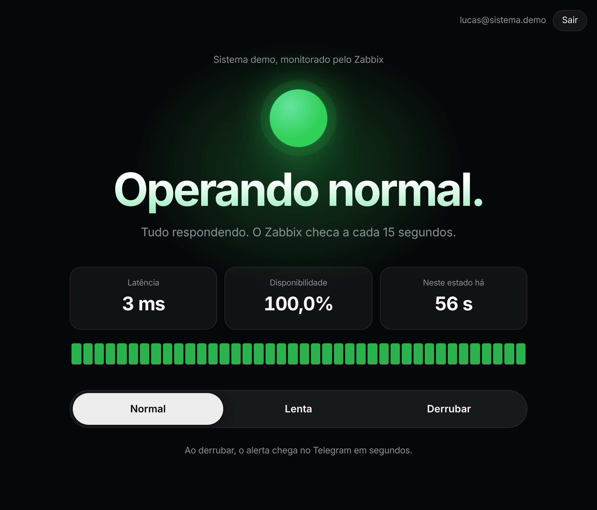
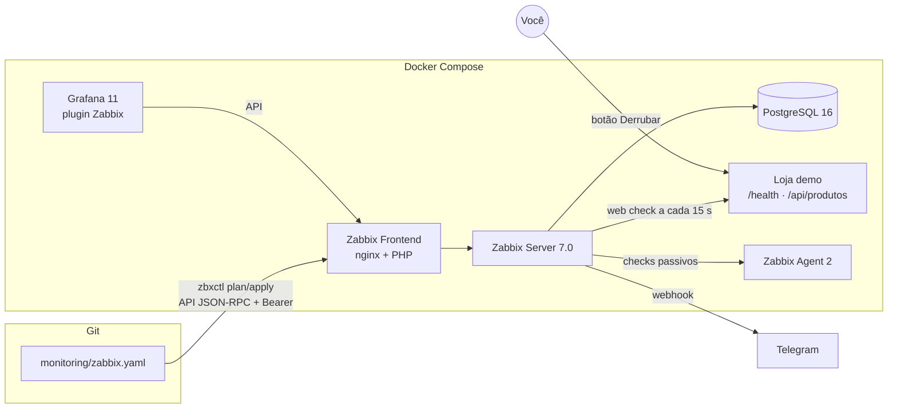

<div align="center">

# zabbix-observability

**Stack de monitoramento com Zabbix 7, Grafana e alertas no Telegram, configurada 100% como código. Inclui uma loja de demonstração com botão de "caos" para provar que o alerta chega.**

[](https://github.com/lucassantana2301-bot/-zabbix-avan-ado-/actions/workflows/ci.yml)




</div>

## Por que este projeto

Configurar Zabbix clicando na interface não escala: ninguém revisa, ninguém sabe o que mudou e recriar o ambiente leva horas. Aqui o monitoramento vive num YAML versionado no Git, e o **zbxctl** aplica no Zabbix com `plan` e `apply`, no mesmo fluxo do Terraform.

```console
$ zbxctl plan
  + host group 'Aplicações'
  + host group 'Infraestrutura'
  + host 'zabbix-agent' (0 web check(s))
  + host 'demo-app' (2 web check(s))
  + web check 'demo-app/Health' (http://demo-app:8000/health)
  + trigger 'Health fora do ar em demo-app' (high)
  + trigger 'Health lento em demo-app' (warning)
  + web check 'demo-app/Catalogo' (http://demo-app:8000/api/produtos)
  + trigger 'Catalogo fora do ar em demo-app' (average)
  + media type 'Telegram (zbxctl)' (webhook)
  ~ user media 'Admin' (a partir de warning)
  + action 'zbxctl: alertas para o Telegram' (severidade >= warning)
Plano: 11 para criar, 1 para alterar, 0 para remover.
```

## O que tem dentro

- **Zabbix 7.0 LTS** (server, frontend e Agent 2) sobre **PostgreSQL 16**, com o esquema criado por um job de init, como no compose oficial.
- **zbxctl**: CLI em Python que lê `monitoring/zabbix.yaml` e sincroniza grupos, hosts, templates, web checks, triggers, media type, mídia do usuário e ação de alerta.
  - Idempotente: rodar `apply` duas vezes não muda nada. O CI garante isso.
  - Remove só o que ele mesmo criou (tag `managed-by=zbxctl`) e nunca apaga o que foi feito à mão.
  - Segredos via `${VARIAVEL}` no YAML, nunca versionados.
- **Alertas no Telegram** por um webhook próprio, com mensagens de problema e de resolvido.
- **Grafana 11** com o plugin do Zabbix e um dashboard provisionados automaticamente.
- **Loja demo** (FastAPI) com modos normal, lento e fora do ar, para simular incidentes.

## Arquitetura



## Como rodar

Requisitos: Docker com Compose e Python 3.11+.

```bash
cp .env.example .env          # preencha TELEGRAM_BOT_TOKEN e TELEGRAM_CHAT_ID para receber alertas
make demo                     # sobe a stack, instala o zbxctl e aplica o monitoramento
```

| Serviço | Endereço | Login |
| --- | --- | --- |
| Zabbix | http://localhost:8080 | Admin / zabbix |
| Grafana | http://localhost:3000 | admin / admin |
| Loja demo (painel de caos) | http://localhost:8000 | — |

Para simular um incidente, abra a loja e clique em **Derrubar**, ou rode `make down`. Em menos de um minuto o Zabbix abre o problema, o Grafana fica vermelho e o Telegram recebe o alerta. `make normal` religa e dispara a mensagem de resolvido.

### Telegram

1. Fale com o **@BotFather**, crie um bot e copie o token.
2. Mande uma mensagem para o bot e pegue seu chat id com o **@userinfobot**.
3. Coloque os dois no `.env` e rode `make apply`.

## Monitoramento como código

```yaml
hosts:
  - name: demo-app
    groups: [Aplicações]
    web_checks:
      - name: Health
        url: http://demo-app:8000/health
        required: '"status":"ok"'
        interval: 15s
        down: { severity: high }
        slow: { threshold_ms: 1500, window: 1m, severity: warning }
```

Cada web check vira um cenário web do Zabbix e até dois triggers:

| Trigger | Expressão gerada |
| --- | --- |
| Queda | `last(/demo-app/web.test.fail[Health])<>0` |
| Lentidão | `avg(/demo-app/web.test.time[Health,Health,resp],1m)>1.5` |

O YAML é validado com Pydantic (`zbxctl validate`) antes de qualquer chamada: campo desconhecido, grupo não declarado, URL sem `http(s)` ou intervalo sem unidade falham no CI, não em produção.

## Qualidade

- **26 testes** do zbxctl contra um Zabbix falso em memória que fala JSON-RPC e exige o header Bearer, cobrindo criação, atualização, remoção seletiva, idempotência, erros da API e CLI.
- **ruff** e **mypy --strict** no CI.
- **Teste ponta a ponta no GitHub Actions** contra o Zabbix real: sobe a stack, aplica o YAML, confere que o segundo `plan` está vazio, derruba a loja, espera o Zabbix abrir o problema, religa, espera a resolução e valida que o Grafana conecta no Zabbix.

## Lições do teste ponta a ponta

O E2E no CI pegou dois problemas que testes com mock nunca pegariam:

1. **Banco recém-criado sem estatísticas.** Logo após o `init_db_only`, o Postgres ainda não tinha rodado `ANALYZE`. A consulta de dependências de triggers, usada ao linkar o template *Linux by Zabbix agent* e na sincronização de configuração do server, escolhia um plano ruim e ficava **mais de 3 minutos** rodando, o que travava o `apply` e atrasava os web checks. O diagnóstico veio de um monitor de `pg_stat_activity` rodando em paralelo no CI. A correção é um passo `zabbix-db-analyze` no compose, entre o init e o server: o `apply` caiu de minutos para **1 segundo**.
2. **`item.get` esconde itens de cenário web.** Sem o parâmetro `webitems: true`, a API não retorna `web.test.fail[...]`. O monitoramento funcionava, mas o teste não enxergava o item.

Resultado da última execução no CI: web check saudável em 15 s, problema aberto **10 s** depois de derrubar a loja e resolvido 15 s depois de religar.

## Segurança

- Portas publicadas só em `127.0.0.1`.
- Autenticação da API pelo header `Authorization: Bearer`, como documentado a partir do Zabbix 7.0 (o campo `auth` no corpo está deprecado).
- Token do Telegram e senhas só em variáveis de ambiente; `.env` no `.gitignore`.
- Botões de caos podem exigir token (`CHAOS_TOKEN`).
- Imagens com usuário não-root na loja demo.

As senhas padrão (`zabbix`, `admin`) existem para a demonstração local. Antes de expor qualquer porta, troque a senha do Admin, crie um API token e use `ZABBIX_API_TOKEN`.

## Estrutura

```
├── compose.yaml                  # Postgres, Zabbix (init, server, web, agent), Grafana, loja
├── monitoring/zabbix.yaml        # o monitoramento, declarado
├── zbxctl/                       # CLI Python: validate, plan, apply, wait
├── demo-app/                     # loja FastAPI com modo caos
├── grafana/                      # plugin, data source e dashboard provisionados
├── scripts/e2e.py                # teste ponta a ponta usado no CI
└── docs/VIDEO.md                 # roteiro da demonstração em vídeo
```

## Roadmap

- [ ] Descoberta automática de containers com o template Docker do Agent 2
- [ ] Monitoramento de certificado TLS e expiração de domínio
- [ ] Exportar/importar templates próprios via `configuration.import`
- [ ] Deploy em VM com Terraform

## Licença

MIT © Lucas Santana Santos
